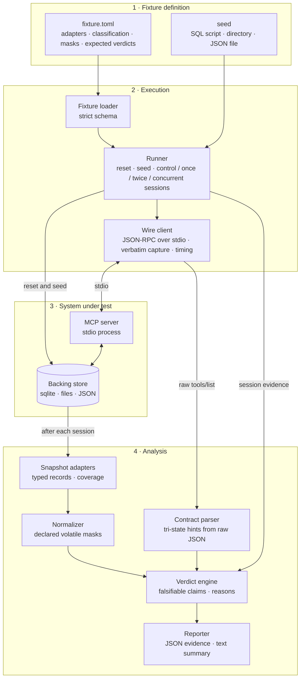

# mcp-groundtruth

[](https://github.com/shreyasbhakta/mcp-groundtruth/actions/workflows/ci.yml)


**A behavioral conformance harness for Model Context Protocol tool annotations.**

MCP servers describe each tool with four behavioral hints: `readOnlyHint`,
`destructiveHint`, `idempotentHint` and `openWorldHint`. The specification
calls them hints and requires clients to treat annotations as untrusted
unless they come from trusted servers [1]. mcp-groundtruth runs the tools
against observable state and checks whether what a tool declares matches
what it does.

> **Scope of release 0.1.** This release tests only the fixture servers in
> this repository, each built with a known expected outcome, to show the
> harness produces correct verdicts. It does not test any third-party MCP
> server and makes no claims about the MCP ecosystem.

---

## Contents

- [How it works](#how-it-works)
- [Verdict model](#verdict-model)
- [Quick start](#quick-start)
- [Command line](#command-line)
- [Reports](#reports)
- [Fixtures](#fixtures)
- [Defining a fixture](#defining-a-fixture)
- [Design guarantees](#design-guarantees)
- [Limitations](#limitations)
- [Development](#development)
- [References](#references)
- [License](#license)

---

## How it works



1. **Reset verification.** The runner resets the store from its seed twice
   and requires the two snapshots to be identical after normalization. If
   they differ, every verdict for that fixture is `RESET_UNVERIFIED`.
2. **Sessions.** Every session starts from a clean reset with the same
   opening: start the server, `initialize`, `tools/list` (all pages).
   - A **control** session stops there.
   - A **once** or **twice** session then calls the tool one or two times.
   - **Concurrent** attempts issue two calls at the same time, either on one
     connection or through two server instances sharing the store.

   State is observed after the server exits.
3. **Declared contracts** are parsed from the `tools/list` response text
   exactly as received. Each hint is `TRUE`, `FALSE` or `ABSENT`, and absent
   is never treated as false.
4. **Observation.** Adapters snapshot each surface into typed, sorted
   records. The normalizer masks only the volatile columns the fixture
   declares. Deltas are reported separately for **business** state,
   **append-only** state (logs, audit rows) and **unclassified** state.
5. **Verdicts** compare the observed behavior with the falsifiable form of
   each hint. Every verdict carries its evidence.

| Test | Hint | Compares | Fails when |
|---|---|---|---|
| sequential idempotence | `idempotentHint` | once vs twice, separate runs from clean reset | business state differs |
| concurrent idempotence | `idempotentHint` | once vs two concurrent calls | business state differs in any attempt |
| read-only | `readOnlyHint` | control vs once | any observed state differs |
| destructive | `destructiveHint` | control vs once | a pre-existing business or append-only record is gone or overwritten |

`openWorldHint` is parsed and reported but not tested in this release: the
harness makes no network access by design.

---

## Verdict model

| Outcome | Meaning |
|---|---|
| `PASS` | A claim that could have failed was tested and held. |
| `VIOLATION` | Behavior contradicts an explicit declaration on observed state, reproduced in at least 3 independent runs (concurrent test: in any attempt). |
| `INCONCLUSIVE` | No judgment possible; carries a reason code. |
| `NOT_APPLICABLE` | Nothing falsifiable to test; carries a reason code. |

Only three declared values make a claim that behavior can contradict:
`readOnlyHint: true`, `destructiveHint: false` and `idempotentHint: true`.
**Violation rates use only these as the denominator.**

| Reason | Applies when |
|---|---|
| `NO_DECLARATION` | The hint was not sent. |
| `MALFORMED_DECLARATION` | The hint was sent, but not as a JSON boolean (`"true"`, `1`, `null`, a duplicated key). |
| `PERMISSIVE_DECLARATION` | The declared value is permissive (`readOnlyHint: false`, `destructiveHint: true`, `idempotentHint: false`). |
| `SUPERSEDED_BY_READ_ONLY` | An explicit `readOnlyHint: true` supersedes the destructive and idempotence tests. |
| `PARTIAL_COVERAGE` | Some declared state location is not observed. Blocks PASS, never VIOLATION. |
| `UNCLASSIFIED_STATE` | The only change is in state the fixture did not classify. |
| `RESET_UNVERIFIED` | Two resets did not produce the same state. |
| `NONDETERMINISTIC` | Runs that should agree did not; the evidence names the differing columns. |
| `CALL_ERROR` | An error response with no state change, or a dead connection. |
| `SETUP_FAILED` | Reset, seeding, server start or listing failed. |
| `NO_OVERLAP_OBSERVED` | Concurrent test: no race seen, and no attempt overlapped. |
| `TWO_PROCESS_SKIPPED_STARTUP_WRITES` | Concurrent test: two-instance attempts skipped because the server writes state on startup or shutdown. |

Each verdict has one primary reason and may list secondary reasons, so a
`CALL_ERROR` stays visible under `NO_DECLARATION`. The concurrent test is
one-sided. A single diverging attempt is a conclusive VIOLATION. A PASS only
means no race was observed. The full rules are in
[docs/methodology.md](docs/methodology.md).

---

## Quick start

Requirements: Python 3.11 or later and [uv](https://docs.astral.sh/uv/).
macOS or Linux.

```bash
git clone https://github.com/shreyasbhakta/mcp-groundtruth.git
cd mcp-groundtruth
uv sync
uv run mcpgt run liar-concurrent
```

```text
liar-concurrent  run 20261014T003848101991Z-liar-concurrent  (3 runs)
  reset: verified
  coverage: complete
  control sessions: stable

  tool      test                     declared  verdict                                observed               expected
  register  sequential_idempotence   true      PASS                                   idempotent=holds       ok
  register  concurrent_idempotence   true      VIOLATION                              idempotent=fails       ok
              attempts: single_connection: 20/20 diverged; two_process: 20/20 diverged,
              overlap in_flight 20; produced by: single_connection, two_process
  register  read_only                false     NOT_APPLICABLE:PERMISSIVE_DECLARATION  read_only=fails        ok
  register  destructive              false     PASS                                   non_destructive=holds  ok

  expectations: 4/4 matched
```

This fixture deduplicates with check-then-insert and no uniqueness
constraint. Sequential calls look idempotent. Concurrent calls both insert.
(Output columns condensed for width.)

---

## Command line

| Command | Purpose |
|---|---|
| `mcpgt verify-reset <fixture> [--json]` | Reset twice and confirm identical normalized state. |
| `mcpgt run <fixture> [--tool NAME] [--runs N] [--concurrent-attempts N] [--runs-dir DIR]` | Run the test battery, write a JSON report, print a summary. |
| `mcpgt report <run-id> [--format text\|json] [--runs-dir DIR]` | Show a saved report. |
| `mcpgt --version` | Print the version. |

`<fixture>` is a directory name under `fixtures/` or a path to a fixture
directory. `--runs` defaults to and may not be below 3.
`--concurrent-attempts` (per mode) defaults to 20.

| Exit code | Meaning |
|---|---|
| `0` | Success: every verdict matched its expectation (`run`), or reset verified (`verify-reset`). |
| `1` | A verdict did not match its expectation (`run`), or reset not verified (`verify-reset`). |
| `2` | Invalid fixture definition, arguments, or run id. |

---

## Reports

`mcpgt run` writes `runs/<run-id>/report.json` (schema `mcpgt.report/0.1`),
a self-contained evidence record:

- **Provenance**:
  - the fixture's source, git SHA, working-tree dirtiness and content digest;
  - the harness's SHA and dirtiness;
  - the SDK version, Python version and capture time.
- **Raw protocol data**: every `tools/list` page and the `initialize`
  response, verbatim, plus every tool response.
- **Reset verification and control sessions**, including the control's own
  effect on the seeded state.
- **Per verdict**:
  - the full tri-state contract;
  - the observed property and behavior;
  - deltas per run, by state category;
  - affected categories;
  - every errored call (session, position, `tool_error` or
    `protocol_error`, and whether state changed);
  - nondeterminism evidence;
  - coverage, run count, and primary and secondary reasons with details.
- **Concurrent verdicts** also carry:
  - every attempt, with its mode, overlap and timings;
  - counts per mode;
  - the mode that produced the verdict.
- **Expectation check** against the fixture's recorded ground truth.

Verdicts and observed deltas are deterministic for a given fixture and
seed. Timestamps, SHAs and timing measurements are capture metadata.

---

## Fixtures

Each fixture is a small, real MCP server over stdio with its expected
verdicts recorded in `fixture.toml`. The harness is correct when every
fixture gets exactly its expected verdicts. `tests/test_ground_truth.py`
enforces this for all 72 (tool, test) pairs.

| Fixture | Behavior | Key expected verdicts |
|---|---|---|
| `honest-readonly` | Declares read-only; only reads. | read-only PASS |
| `honest-idempotent` | Upsert by key; one audit row per call. | sequential PASS; concurrent PASS |
| `liar-idempotent` | Declares idempotent; inserts a row per call. | sequential and concurrent VIOLATION |
| `liar-concurrent` | Check-then-insert with no uniqueness constraint. | sequential PASS; concurrent VIOLATION |
| `liar-readonly` | Declares read-only; writes an append-only log. | read-only VIOLATION |
| `silent-safe` | Declares nothing; genuinely idempotent. | NO_DECLARATION; behavior reported as idempotent |
| `opaque` | Real state in a file no adapter observes. | PARTIAL_COVERAGE, never PASS |
| `flaky` | Random token per call. | NONDETERMINISTIC, naming the column |
| `malformed-hints` | Hand-written JSON-RPC server emitting string, number, null, duplicate-key and list annotations. | MALFORMED_DECLARATION |
| `liar-readonly-error` | Declares read-only; writes, then returns `isError`. | VIOLATION with side effects; a clean failure is CALL_ERROR |
| `startup-writer` | Writes a boot-log row on every start. | read-only PASS; concurrent NO_OVERLAP_OBSERVED |

---

## Defining a fixture

```toml
[fixture]
name = "honest-idempotent"
command = ["{python}", "server.py"]          # {python} is the harness interpreter

[state]
locations = ["sqlite:state.db"]              # ground truth: every place the server keeps state

[[adapters]]
kind = "sqlite"                              # sqlite | fs | json
label = "state.db"                           # observed at <state dir>/state.db
seed = "seed.sql"
business = ["items"]
append_only = ["audit"]
mask = [{ region = "audit", column = "at", kind = "timestamp" }]

[[tools]]
name = "upsert_item"
arguments = { key = "a", value = "new" }

[tools.expected.sequential_idempotence]
verdict = "PASS"
append_only_changed = true
```

The server finds its state directory in `MCPGT_STATE_DIR`. Definitions are
parsed strictly: unknown keys are errors, and every mask rule must match the
seeded state. This prevents a typo from silently changing what is compared.

---

## Design guarantees

- **Absence is never false.** Hints are an explicit tri-state type that
  refuses boolean coercion and comparison. The specification's defaults are
  never applied.
- **Raw-byte contracts.** Contracts are parsed from the response text as
  received, not from SDK models. In `mcp==2.3.0` the SDK models coerce
  `"true"` and `1` to `True`. They also fail the entire listing on one
  malformed tool. `tests/test_sdk_divergence.py` pins this behavior.
- **No overclaiming.**
  - Incomplete coverage cannot PASS.
  - Unverified resets and unstable runs cannot be judged.
  - Concurrent PASS requires observed overlap.
- **Evidence-first.** A verdict without its evidence is treated as a defect.
- **Deterministic and offline.** The harness makes no network calls and
  needs no external services.

---

## Limitations

- Release 0.1 tests only the fixtures in this repository. It does not test
  real servers.
- Tool arguments come from the fixture definition. The harness does not
  generate inputs.
- Observation covers SQLite databases, directory trees and JSON document
  files. State held only in process memory, or anywhere else undeclared,
  makes coverage partial.
- Concurrent overlap for two-instance attempts uses a timing heuristic:
  both calls in flight for longer than the instances' ping round-trip times
  combined. Overlap on a single connection is never assumed.
- The concurrent behavior of undeclared tools is out of scope.
- `openWorldHint` is reported but not tested.

---

## Development

```bash
uv sync                          # runtime and development dependencies
uv run pytest                    # full suite, including all fixtures end to end
uv run ruff check . && uv run ruff format --check .
uv run mypy                      # strict type checking
```

```text
src/mcpgt/
  contracts.py   tri-state hints, strict parsing of raw tools/list
  wire.py        JSON-RPC stdio client with verbatim capture and timing
  snapshot.py    sqlite / fs / json adapters, coverage, classification, deltas
  normalize.py   declared volatile-field masking
  fixture.py     strict fixture definitions
  runner.py      reset, sessions, concurrent attempts, evidence collection
  verdict.py     verdict derivation and declaration coherence
  report.py      JSON reports, expectation checks, text summary
  provenance.py  source, harness and capture provenance
  cli.py         command line
fixtures/        ground-truth servers
docs/            methodology
tests/
```

CI runs lint, strict type checking and the full suite on Python 3.11 and
3.14.

---

## References

1. Model Context Protocol. *Specification, version 2025-11-25: Tools*
   (tool annotations and trust).
   <https://modelcontextprotocol.io/specification/2025-11-25/server/tools>
2. A. Trofimov and B. Novikov. *When Tool Calls Succeed but Workflows Fail:
   Anomalies at the Agent-Tool Boundary.* arXiv:2609.15397, 2026.
   <https://arxiv.org/abs/2609.15397>
3. H. M. Afsar. *What a Random Draw from the MCP Registry Contains, and What
   Tool-Use Benchmarks Contain Instead.* arXiv:2609.10962, 2026.
   <https://arxiv.org/abs/2609.10962>
4. Model Context Protocol Python SDK, version 2.3.0 (MIT License).
   <https://github.com/modelcontextprotocol/python-sdk>

References 2 and 3 study what MCP servers declare and expose. This project
is complementary: it executes tools to check declarations against behavior.
It does not reproduce or restate their findings.

---

## License

Apache License 2.0. See [LICENSE](LICENSE) and [NOTICE](NOTICE).
