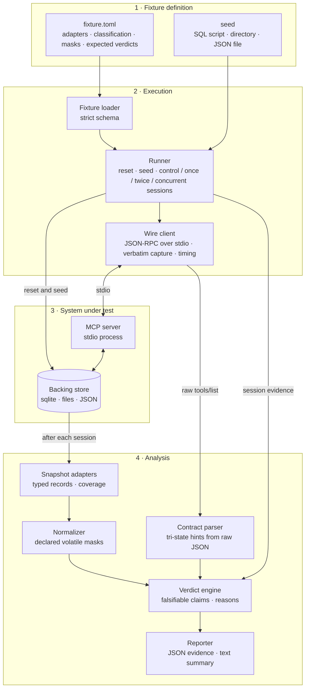

# mcp-groundtruth

[](https://github.com/shreyasbhakta/mcp-groundtruth/actions/workflows/ci.yml)


**A behavioral conformance harness for Model Context Protocol tool annotations.**

MCP servers describe each tool with four behavioral hints: `readOnlyHint`,
`destructiveHint`, `idempotentHint` and `openWorldHint`. The specification
calls them hints and requires clients to treat annotations as untrusted
unless they come from trusted servers [1]. mcp-groundtruth runs the tools
against observable state and checks whether what a tool declares matches
what it does.

> **Scope of release 0.1.** This release tests only the fixture servers in
> this repository, each built with a known expected outcome, to show the
> harness produces correct verdicts. It does not test any third-party MCP
> server and makes no claims about the MCP ecosystem.

---

## Contents

- [How it works](#how-it-works)
- [Verdict model](#verdict-model)
- [Quick start](#quick-start)
- [Command line](#command-line)
- [Reports](#reports)
- [Fixtures](#fixtures)
- [Defining a fixture](#defining-a-fixture)
- [Auditing third-party servers](#auditing-third-party-servers)
- [Network side effects](#network-side-effects)
- [Audit results](#audit-results)
- [Design guarantees](#design-guarantees)
- [Limitations](#limitations)
- [Development](#development)
- [Related work](#related-work)
- [References](#references)
- [License](#license)

---

## How it works



1. **Reset verification.** The runner resets the store from its seed twice
   and requires the two snapshots to be identical after normalization. If
   they differ, every verdict for that fixture is `RESET_UNVERIFIED`.
2. **Sessions.** Every session starts from a clean reset with the same
   opening: start the server, `initialize`, `tools/list` (all pages).
   - A **control** session stops there.
   - A **once** or **twice** session then calls the tool one or two times.
   - **Concurrent** attempts issue two calls at the same time, either on one
     connection or through two server instances sharing the store.

   State is observed after the server exits.
3. **Declared contracts** are parsed from the `tools/list` response text
   exactly as received. Each hint is `TRUE`, `FALSE` or `ABSENT`, and absent
   is never treated as false.
4. **Observation.** Adapters snapshot each surface into typed, sorted
   records. The normalizer masks only the volatile columns the fixture
   declares. Deltas are reported separately for **business** state,
   **append-only** state (logs, audit rows) and **unclassified** state.
5. **Verdicts** compare the observed behavior with the falsifiable form of
   each hint. Every verdict carries its evidence.

| Test | Hint | Compares | Fails when |
|---|---|---|---|
| sequential idempotence | `idempotentHint` | once vs twice, separate runs from clean reset | business state differs |
| concurrent idempotence | `idempotentHint` | once vs two concurrent calls | business state differs in any attempt |
| read-only | `readOnlyHint` | control vs once | any observed state differs |
| destructive | `destructiveHint` | control vs once | a pre-existing business or append-only record is gone or overwritten |

`openWorldHint` is parsed and reported but not tested in this release: the
harness makes no network access by design.

---

## Verdict model

| Outcome | Meaning |
|---|---|
| `PASS` | A claim that could have failed was tested and held. |
| `VIOLATION` | Behavior contradicts an explicit declaration on observed state, reproduced in at least 3 independent runs (concurrent test: in any attempt). |
| `INCONCLUSIVE` | No judgment possible; carries a reason code. |
| `NOT_APPLICABLE` | Nothing falsifiable to test; carries a reason code. |

Only three declared values make a claim that behavior can contradict:
`readOnlyHint: true`, `destructiveHint: false` and `idempotentHint: true`.
**Violation rates use only these as the denominator.**

| Reason | Applies when |
|---|---|
| `NO_DECLARATION` | The hint was not sent. |
| `MALFORMED_DECLARATION` | The hint was sent, but not as a JSON boolean (`"true"`, `1`, `null`, a duplicated key). |
| `PERMISSIVE_DECLARATION` | The declared value is permissive (`readOnlyHint: false`, `destructiveHint: true`, `idempotentHint: false`). |
| `SUPERSEDED_BY_READ_ONLY` | An explicit `readOnlyHint: true` supersedes the destructive and idempotence tests. |
| `PARTIAL_COVERAGE` | Some declared state location is not observed. Blocks PASS, never VIOLATION. |
| `UNCLASSIFIED_STATE` | The only change is in state the fixture did not classify. |
| `RESET_UNVERIFIED` | Two resets did not produce the same state. |
| `NONDETERMINISTIC` | Runs that should agree did not; the evidence names the differing columns. |
| `CALL_ERROR` | An error response with no state change, or a dead connection. |
| `SETUP_FAILED` | Reset, seeding, server start or listing failed. |
| `NO_OVERLAP_OBSERVED` | Concurrent test: no race seen, and no attempt overlapped. |
| `TWO_PROCESS_SKIPPED_STARTUP_WRITES` | Concurrent test: two-instance attempts skipped because the server writes state on startup or shutdown. |

Each verdict has one primary reason and may list secondary reasons, so a
`CALL_ERROR` stays visible under `NO_DECLARATION`. The concurrent test is
one-sided. A single diverging attempt is a conclusive VIOLATION. A PASS only
means no race was observed. The full rules are in
[docs/methodology.md](https://github.com/shreyasbhakta/mcp-groundtruth/blob/main/docs/methodology.md).

---

## Quick start

Requirements: Python 3.11 or later. macOS or Linux.

Install the `mcpgt` command:

```bash
pip install mcp-groundtruth                # install from PyPI
uvx --from mcp-groundtruth mcpgt --help    # or run it without installing
```

To test your own server, follow [Test your own MCP server](https://github.com/shreyasbhakta/mcp-groundtruth/blob/main/docs/your-server.md),
which walks a small example server from `mcpgt init` to a report and shows
how to gate CI on it with this repository's GitHub Action.
To run this repository's fixtures, use a checkout and
[uv](https://docs.astral.sh/uv/):

```bash
git clone https://github.com/shreyasbhakta/mcp-groundtruth.git
cd mcp-groundtruth
uv sync
uv run mcpgt run liar-concurrent
```

```text
liar-concurrent  run 20261014T003848101991Z-liar-concurrent  (3 runs)
  reset: verified
  coverage: complete
  control sessions: stable

  tool      test                     declared  verdict                                observed               expected
  register  sequential_idempotence   true      PASS                                   idempotent=holds       ok
  register  concurrent_idempotence   true      VIOLATION                              idempotent=fails       ok
              attempts: single_connection: 20/20 diverged; two_process: 20/20 diverged,
              overlap in_flight 20; produced by: single_connection, two_process
  register  read_only                false     NOT_APPLICABLE:PERMISSIVE_DECLARATION  read_only=fails        ok
  register  destructive              false     PASS                                   non_destructive=holds  ok

  expectations: 4/4 matched
```

This fixture deduplicates with check-then-insert and no uniqueness
constraint. Sequential calls look idempotent. Concurrent calls both insert.
(Output columns condensed for width.)

---

## Command line

| Command | Purpose |
|---|---|
| `mcpgt init <dir> [--name N] [--env K=V] [--force] [--no-sandbox] -- <server command>` | Start a server, list its tools, and write a starting `target.toml` with `TODO(mcpgt)` placeholders for everything only you can decide. |
| `mcpgt verify-reset <fixture> [--json]` | Reset twice and confirm identical normalized state. |
| `mcpgt run <fixture> [--tool NAME] [--runs N] [--concurrent-attempts N] [--runs-dir DIR]` | Run the test battery, write a JSON report, print a summary. |
| `mcpgt prepare <target>` | Fetch and build an audit target's pinned source (the only networked step). |
| `mcpgt run <target> --audit [--observe-concurrent] [--fail-on-violation]` | Audit a server: no expected verdicts, sandboxed. Exits 0 whatever the verdicts, unless `--fail-on-violation` is given. `--observe-concurrent` adds observation-only concurrent attempts for tools without a falsifiable idempotence claim. |
| `mcpgt report <run-id> [--format text\|json] [--runs-dir DIR]` | Show a saved report. |
| `mcpgt --version` | Print the version. |

`<fixture>` / `<target>` is a directory name under `fixtures/` or `targets/`,
or a path to one. `--runs` defaults to and may not be below 3.
`--concurrent-attempts` (per mode) defaults to 20. `--tool` is repeatable and
takes a tool name (all its argument variants) or one variant as
`name[variant]`.

| Exit code | Meaning |
|---|---|
| `0` | Success: every verdict matched its expectation (`run`), or reset verified (`verify-reset`). |
| `1` | A verdict did not match its expectation (`run`), any verdict is VIOLATION (`run --fail-on-violation`), or reset not verified (`verify-reset`). |
| `2` | Invalid fixture definition, arguments, or run id. |

---

## Reports

`mcpgt run` writes `runs/<run-id>/report.json` (schema `mcpgt.report/0.2`),
a self-contained evidence record:

- **Provenance**:
  - the fixture's source, git SHA, working-tree dirtiness and content digest;
  - the harness's SHA and dirtiness;
  - the SDK version, Python version and capture time.
- **Raw protocol data**: every `tools/list` page and the `initialize`
  response, verbatim, plus every tool response.
- **Reset verification and control sessions**, including the control's own
  effect on the seeded state.
- **Per verdict**:
  - the full tri-state contract;
  - the observed property and behavior;
  - deltas per run, by state category;
  - affected categories;
  - every errored call (session, position, `tool_error` or
    `protocol_error`, and whether state changed);
  - nondeterminism evidence;
  - coverage, run count, and primary and secondary reasons with details.
- **Concurrent verdicts** also carry:
  - every attempt, with its mode, overlap and timings;
  - counts per mode;
  - the mode that produced the verdict.
- **Expectation check** against the fixture's recorded ground truth.

Verdicts and observed deltas are deterministic for a given fixture and
seed. Timestamps, SHAs and timing measurements are capture metadata.

---

## Fixtures

Each fixture is a small, real MCP server over stdio with its expected
verdicts recorded in `fixture.toml`. The harness is correct when every
fixture gets exactly its expected verdicts. `tests/test_ground_truth.py`
enforces this for all 72 (tool, test) pairs.

| Fixture | Behavior | Key expected verdicts |
|---|---|---|
| `honest-readonly` | Declares read-only; only reads. | read-only PASS |
| `honest-idempotent` | Upsert by key; one audit row per call. | sequential PASS; concurrent PASS |
| `liar-idempotent` | Declares idempotent; inserts a row per call. | sequential and concurrent VIOLATION |
| `liar-concurrent` | Check-then-insert with no uniqueness constraint. | sequential PASS; concurrent VIOLATION |
| `liar-readonly` | Declares read-only; writes an append-only log. | read-only VIOLATION |
| `silent-safe` | Declares nothing; genuinely idempotent. | NO_DECLARATION; behavior reported as idempotent |
| `opaque` | Real state in a file no adapter observes. | PARTIAL_COVERAGE, never PASS |
| `flaky` | Random token per call. | NONDETERMINISTIC, naming the column |
| `malformed-hints` | Hand-written JSON-RPC server emitting string, number, null, duplicate-key and list annotations. | MALFORMED_DECLARATION |
| `liar-readonly-error` | Declares read-only; writes, then returns `isError`. | VIOLATION with side effects; a clean failure is CALL_ERROR |
| `startup-writer` | Writes a boot-log row on every start. | read-only PASS; concurrent NO_OVERLAP_OBSERVED |
| `network-side-effects` | Read-only tools that beacon, look up a name, upload a planted secret, or start an unobservable child. | read-only PASS for all; network VIOLATION, VIOLATION, VIOLATION and PARTIAL_OBSERVATION |

---

## Defining a fixture

```toml
[fixture]
name = "honest-idempotent"
command = ["{python}", "server.py"]          # {python} is the harness interpreter

[state]
locations = ["sqlite:state.db"]              # ground truth: every place the server keeps state

[[adapters]]
kind = "sqlite"                              # sqlite | fs | json
label = "state.db"                           # observed at <state dir>/state.db
seed = "seed.sql"
business = ["items"]
append_only = ["audit"]
mask = [{ region = "audit", column = "at", kind = "timestamp" }]

[[tools]]
name = "upsert_item"
arguments = { key = "a", value = "new" }

[tools.expected.sequential_idempotence]
verdict = "PASS"
append_only_changed = true
```

The server finds its state directory in `MCPGT_STATE_DIR`. Commands and
`env` values may use `{python}` (the harness interpreter), `{state}` (the
state directory), `{target}` (the definition's directory) and, for targets
with a `[source]`, `{source}` (the prepared checkout). Definitions are parsed
strictly: unknown keys are errors, every mask rule must match the seeded
state, and any value still starting with `TODO(mcpgt)` stops the definition
from loading. This prevents a typo or a forgotten decision from silently
changing what is compared.

---

## Auditing third-party servers

*Since 0.2.0.* Audit targets live in `targets/`.
Each pins a repository commit and a Node major version, builds it locally,
and runs it in a sandbox with no network access. Targets never carry
expected verdicts; audit reports are measurements for review.

| Platform | Network | File writes | Notes |
|---|---|---|---|
| macOS | denied (`sandbox-exec`) | confined to the state directory | full isolation |
| Linux | denied (`unshare --net`) | **not confined** | needs unprivileged user namespaces |
| Linux without user namespaces | — | — | audits refuse to run; sandbox tests are skipped in CI | `targets/memory` pins the reference memory server
from `modelcontextprotocol/servers`. See
[docs/methodology.md](https://github.com/shreyasbhakta/mcp-groundtruth/blob/main/docs/methodology.md#audit-targets).

```bash
export PATH="/path/to/node-v24/bin:$PATH"   # the target pins Node 24
uv run mcpgt prepare memory          # fetch the pinned commit and build it
uv run mcpgt verify-reset memory     # prove the seeded state resets exactly
uv run mcpgt run memory --audit      # sandboxed audit, full evidence report
```

---

## Network side effects

*Since 0.3.0.* A tool can return the right answer, change no
stored state and declare itself read-only, and still send your data
somewhere. Add a `[network]` section to a definition, and the harness:

- runs the server in the sandbox;
- records every connection, lookup and upload it attempts, with an observer
  library preloaded into the server;
- receives anything it manages to send at a local capture endpoint that
  forwards nothing;
- plants a synthetic secret and reports where it turned up.

```toml
[network]
policy = "deny"   # deny | allowlist | permitted
capture = true
```

```text
  tool                       verdict                            attempted  blocked  sent  canary  destinations
  read_note                  PASS                                       0        0     0      no  -
  read_note_and_beacon       VIOLATION                                  9        9     0      no  192.0.2.1:443
  read_note_and_upload       VIOLATION                                  9        0     9     yes  capture, collector.invalid:80
  read_note_with_helper      INCONCLUSIVE:PARTIAL_OBSERVATION           0        0     0      no  -
```

An attempt and a transmission are reported separately. Missing or partial
observation is INCONCLUSIVE, never PASS, and without a sandbox the run
refuses to start. It runs on macOS and on Linux (with unprivileged user
namespaces); both are tested end to end in CI. Details,
configuration, guarantees and gaps:
[docs/network.md](https://github.com/shreyasbhakta/mcp-groundtruth/blob/main/docs/network.md).

---

## Audit results

Two servers have been audited, both from `modelcontextprotocol/servers@bbb701e`,
each with one seeded state, under Node 24 on macOS. The results say nothing
about other servers or other versions of these.

| Server | Tools (argument sets) | Violations | Over-declarations | Network attempts | Review |
|---|---|---|---|---|---|
| memory (`@modelcontextprotocol/server-memory` 1.0.0) | 9 (one each, and 12 for the three create/add tools) | none | 3: `create_entities`, `create_relations` and `add_observations` declare `idempotentHint: false`, but a repeated identical call changed nothing; [fixed upstream](https://github.com/modelcontextprotocol/servers/pull/5349) | none ([review](https://github.com/shreyasbhakta/mcp-groundtruth/blob/main/results/network-2026-10-25/REVIEW.md)) | [REVIEW.md](https://github.com/shreyasbhakta/mcp-groundtruth/blob/main/results/memory-2026-10-14/REVIEW.md) |
| filesystem (`@modelcontextprotocol/server-filesystem` 1.0.0) | 14 (22) | none | 1: `move_file` declares `idempotentHint: false`; a repeat changes nothing but reports an error, so `false` is defensible | none ([review](https://github.com/shreyasbhakta/mcp-groundtruth/blob/main/results/network-2026-10-25/REVIEW.md)) | [REVIEW.md](https://github.com/shreyasbhakta/mcp-groundtruth/blob/main/results/filesystem-2026-10-14/REVIEW.md) |

---

## Design guarantees

- **Absence is never false.** Hints are an explicit tri-state type that
  refuses boolean coercion and comparison. The specification's defaults are
  never applied.
- **Raw-byte contracts.** Contracts are parsed from the response text as
  received, not from SDK models. In `mcp==2.3.0` the SDK models coerce
  `"true"` and `1` to `True`. They also fail the entire listing on one
  malformed tool. `tests/test_sdk_divergence.py` pins this behavior.
- **No overclaiming.**
  - Incomplete coverage cannot PASS.
  - Unverified resets and unstable runs cannot be judged.
  - Concurrent PASS requires observed overlap.
- **Evidence-first.** A verdict without its evidence is treated as a defect.
- **Deterministic and offline.** The harness makes no network calls and
  needs no external services.

---

## Limitations

- **stdio servers only.** Streamable HTTP and other transports are not
  supported.
- **Network observation is best effort.** It sees libc calls in processes
  that loaded the observer. Raw system calls, statically linked binaries and
  unobserved children are not seen; unobserved children are reported as
  coverage gaps. A server written to evade it can, but it cannot evade the
  sandbox. See
  [docs/network.md](https://github.com/shreyasbhakta/mcp-groundtruth/blob/main/docs/network.md#known-gaps).
- **State in SQLite, files or JSON only.** Observation covers SQLite
  databases, files and directory trees, and JSON or JSON Lines files.
  State held anywhere else (process memory, another database, a remote
  service) cannot be observed. If it is declared, coverage is partial and
  verdicts that depend on it are INCONCLUSIVE. If it is not declared, it is
  not seen at all. An `fs` adapter on `.` observes the whole state
  directory, and on macOS audits block writes outside it.
- **`mcpgt prepare` supports git sources only.** It fetches one commit,
  named by its full 40-character SHA, of a git repository (the host must
  allow fetching by SHA, as GitHub does). It then runs the target's build
  commands in the checkout. Those commands run unsandboxed and with network
  access, so review them. Only a Node major version can be pinned
  (`node = "24"`). Package name and version are read from `package.json`
  only. Toolchain versions are recorded only for `node` and `npm`. Servers
  in other languages can be built with their own commands, but their
  toolchains are neither pinned nor recorded. Targets without a `[source]`
  run the command as given, and their provenance is the definition alone.
- Tool arguments come from the definition. The harness does not generate
  inputs; `mcpgt init` writes placeholders for you to fill in.
- On Linux, audit isolation blocks network but does not confine file
  writes; see [Auditing third-party servers](#auditing-third-party-servers).
- Concurrent overlap for two-instance attempts uses a timing heuristic:
  both calls in flight for longer than the instances' ping round-trip times
  combined. Overlap on a single connection is never assumed.
- Concurrent verdicts are given only for tools declaring
  `idempotentHint: true`. `--observe-concurrent` records concurrent attempts
  for the others, without changing their verdicts.
- `openWorldHint` is reported but not tested.

---

## Development

```bash
uv sync                          # runtime and development dependencies
uv run pytest                    # full suite, including all fixtures end to end
uv run ruff check . && uv run ruff format --check .
uv run mypy                      # strict type checking
```

```text
src/mcpgt/
  contracts.py   tri-state hints, strict parsing of raw tools/list
  wire.py        JSON-RPC stdio client with verbatim capture and timing
  snapshot.py    sqlite / fs / json adapters, coverage, classification, deltas
  normalize.py   declared volatile-field masking
  fixture.py     strict fixture definitions
  runner.py      reset, sessions, concurrent attempts, evidence collection
  verdict.py     verdict derivation and declaration coherence
  report.py      JSON reports, expectation checks, text summary
  provenance.py  source, harness and capture provenance
  sources.py     pinned third-party sources: prepare and offline verification
  sandbox.py     network-free (and on macOS write-confined) server processes
  cli.py         command line
fixtures/        ground-truth servers
targets/         audit targets (no expected verdicts)
docs/            methodology
tests/
```

CI runs lint, strict type checking and the full suite on Python 3.11 and
3.14.

---

## Related work

Other work also executes MCP tools or studies duplicate side effects. The
descriptions below follow each project's own documentation as checked on
2026-10-13.

- **junhecui/mcp-conformance** [5] sets out to execute MCP tools under
  observation and compare declared annotations with observed behavior. Its
  design observes at the kernel boundary: an overlayfs upper layer as the
  filesystem changeset, a network namespace as the connection log, and
  seccomp denials as attempted escapes. It also plans a census pipeline that
  measures annotation presence without execution, treats
  `destructiveHint` as semantic rather than mechanically verifiable, and has
  `unverifiable` as a first-class verdict. Its README describes its status as
  "Pre-implementation. No code yet."
- **studiomeyer-io/mcp-hook-conformance** [6] is a CLI that audits MCP
  servers for being called from agent lifecycle hooks. It checks idempotency
  by comparing a tool's output across identical calls, and checks that
  read-only tools do not mutate state through a configured state probe: a
  call to another tool on the same server. Without a probe that check
  returns `INDETERMINATE`. It also has latency, determinism and
  documentation suites.
- **Li, "Where Does Exactly-Once Live?"** [7] benchmarks duplicate side
  effects in LLM agents across model, agent harness and tool contract, in a
  deterministic sandbox of six services with injected faults, and measures
  how idempotency keys change the duplicate rate. It studies agent behavior
  around writes rather than whether a tool's annotations are accurate.

How this project differs, stated without any claim of priority:

- **Idempotence is judged on final backing state**, from two independent
  runs from a clean reset (once against twice), not on tool output.
- **Observation is record-aware** for databases and structured stores (SQLite
  rows, JSON and JSONL documents), and separates business, append-only and
  unclassified state, so an audit row per call does not make an upsert look
  non-idempotent.
- **Concurrency is tested**, including two server instances sharing one
  store, with per-attempt overlap evidence.
- **Control sessions and reset verification** separate a tool's effects from
  server startup and shutdown and from an unreliable reset.
- **Contracts are parsed strictly at the wire level**, with the documented
  divergence from how the MCP Python SDK reads the same bytes.

What the junhecui/mcp-conformance design covers that this project does not:
**network observation**, so `openWorldHint` can be tested (it is not tested
here), and **filesystem coverage without per-server configuration**, where
this project needs adapters, classification and masks declared for each
server.

---

## References

1. Model Context Protocol. *Specification, version 2025-11-25: Tools*
   (tool annotations and trust).
   <https://modelcontextprotocol.io/specification/2025-11-25/server/tools>
2. A. Trofimov and B. Novikov. *When Tool Calls Succeed but Workflows Fail:
   Anomalies at the Agent-Tool Boundary.* arXiv:2609.15397, 2026.
   <https://arxiv.org/abs/2609.15397>
3. H. M. Afsar. *What a Random Draw from the MCP Registry Contains, and What
   Tool-Use Benchmarks Contain Instead.* arXiv:2609.10962, 2026.
   <https://arxiv.org/abs/2609.10962>
4. Model Context Protocol Python SDK, version 2.3.0 (MIT License).
   <https://github.com/modelcontextprotocol/python-sdk>
5. J. Cui. *mcp-conformance: MCP Annotation Conformance Harness.* GitHub
   repository, accessed 2026-10-13.
   <https://github.com/junhecui/mcp-conformance>
6. StudioMeyer. *mcp-hook-conformance.* GitHub repository (MIT License),
   accessed 2026-10-13.
   <https://github.com/studiomeyer-io/mcp-hook-conformance>
7. J. Li. *Where Does Exactly-Once Live? Model, Harness, and Tool-Contract
   Effects on Duplicate Side Effects in LLM Agents.* arXiv:2609.29095, 2026.
   <https://arxiv.org/abs/2609.29095>

References 2 and 3 study what MCP servers declare and expose; this project
does not reproduce or restate their findings. Work that also executes tools
is discussed under [Related work](#related-work).

---

## License

Apache License 2.0. See [LICENSE](https://github.com/shreyasbhakta/mcp-groundtruth/blob/main/LICENSE) and [NOTICE](https://github.com/shreyasbhakta/mcp-groundtruth/blob/main/NOTICE).
