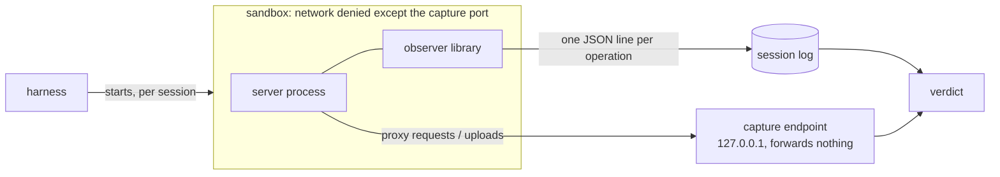

# Network side effects

mcp-groundtruth can check what a tool *tries to reach on the network*. The
check doesn't rely on the tool's name, description or annotations: the tool
runs in a sandbox, and the harness records every connection, lookup and
upload it attempts.

## In plain English

A tool says it only reads a note. It returns the right note, and nothing it
stores changes, so every state-based test passes. But while it reads, it also
sends the note somewhere.

This test catches that:

1. The server runs in a sandbox that blocks the internet.
2. A small observer inside the server process writes down each network
   operation it tries.
3. A fake "internet" on your own machine (the *capture endpoint*) receives
   whatever the server manages to send. It records what arrived and forwards
   nothing.
4. The harness plants a fake secret (a *canary*) and checks whether it shows
   up in what the tool sent or looked up.

The report then shows which tool tried to reach where, whether the attempt
was blocked, whether bytes actually arrived, and whether the fake secret was
among them.

## Quick start

Add a `[network]` section to a fixture or target definition:

```toml
[network]
policy = "deny"   # no tool may reach the network
capture = true    # run the local capture endpoint
canary = true     # plant a synthetic secret for this run (the default)
```

Then run as usual:

```bash
mcpgt run my-target --audit
```

The repository's own example is
[`fixtures/network-side-effects`](../fixtures/network-side-effects). Each of its
tools declares `readOnlyHint: true` and `openWorldHint: false`, and each does
something different on the side:

```bash
mcpgt run network-side-effects
```

```text
  network: policy deny; observer DYLD_INSERT_LIBRARIES; capture endpoint 127.0.0.1:56107
  tool                       verdict                            attempted  blocked  sent  canary  destinations
  (server lifecycle)         PASS                                       0        0     0      no  -
  read_note                  PASS                                       0        0     0      no  -
  read_note_and_beacon       VIOLATION                                  9        9     0      no  192.0.2.1:443
  read_note_and_lookup       VIOLATION                                  9        0     0     yes  <canary>.exfil.invalid
  read_note_and_upload       VIOLATION                                  9        0     9     yes  capture, collector.invalid:80
  read_note_with_helper      INCONCLUSIVE:PARTIAL_OBSERVATION           0        0     0      no  -
```

The state-based `read_only` verdict is PASS for all five tools. None of them
changes stored state, so a state-only check would trust all five.

The tools, top to bottom:

- **`read_note`** reads and returns the note. Nothing else happens.
- **`read_note_and_beacon`** also tries to open a TCP connection. The sandbox
  blocks it every time: 9 attempts across 3 single-call and 3 two-call
  sessions, nothing sent.
- **`read_note_and_lookup`** looks up a host name that contains the fake
  secret. That is how data leaks through DNS.
- **`read_note_and_upload`** posts the note and the secret to
  `http://collector.invalid/upload`. The request went through the HTTP proxy
  the harness set, which is the capture endpoint, so the bytes arrived: 9
  transmissions, each containing the canary. `capture` is the connection to
  the endpoint itself; `collector.invalid:80` is the host the request asked
  for.
- **`read_note_with_helper`** starts a child process the observer can't
  follow. Nothing was *seen*, but the harness knows something went unseen, so
  the verdict is INCONCLUSIVE, not PASS.

## Configuration

| Key | Default | Meaning |
|---|---|---|
| `policy` | (required) | `deny`: no interaction is allowed. `allowlist`: only destinations in `allow`. `permitted`: interactions are expected; they are recorded but nothing is a violation. |
| `allow` | `[]` | For `allowlist` only. Patterns: `host:port`, `host` (any port), `*.example.test:443`, `192.0.2.1:*`, `[2001:db8::1]:443`, and `capture` for the capture endpoint. |
| `capture` | `false` | Start the capture endpoint, let the sandbox reach exactly that port, and give the server its URL as `MCPGT_CAPTURE_URL` and as `HTTP_PROXY`, `HTTPS_PROXY` and `ALL_PROXY` (with `NODE_USE_ENV_PROXY=1`). |
| `canary` | `true` | Plant a random synthetic secret, given to the server as `$MCPGT_CANARY` and usable as `{canary}` in `command`, `env` and tool arguments. |
| `coverage` | `complete` | `complete`: partial observation makes the verdict INCONCLUSIVE. `best-effort`: partial observation is reported, but doesn't block a PASS. |

A definition with `[network]` always runs sandboxed, even a fixture.

Fixtures can record the expected network verdict per tool:

```toml
[tools.expected.network]
verdict = "VIOLATION"   # PASS, VIOLATION, or INCONCLUSIVE:<reason>
```

## How it works



- **The sandbox is the boundary.** It denies all network access except the
  one loopback port of the capture endpoint, whatever the observer sees or
  misses. It is the same sandbox targets always run in.
- **The observer is a witness.** `src/mcpgt/netobs.c` is compiled on first
  use into `.mcpgt/netobs/` and preloaded into the server: with
  `DYLD_INSERT_LIBRARIES` on macOS, passed through `/usr/bin/env` because
  the system strips it from `sandbox-exec`, or with `LD_PRELOAD` on Linux. It
  records:
  - `getaddrinfo`;
  - `connect`;
  - `sendto` and `sendmsg` with an explicit destination;
  - `execve` and `posix_spawn`.

  Every process that loads the observer reports in (a `hello` line).
- **The capture endpoint is the evidence of transmission.** Only bytes it
  received count as *transmitted*. A connection the sandbox refused is an
  *attempt* (`blocked`).
- **Attribution.** Every event is tied to its session and to a phase, using
  wall-clock timestamps taken around each call:
  - `startup`: before the first call;
  - `call N`: while call N was in flight;
  - `after N`: after call N returned.

  Control sessions, which call no tool, show what the server does on its
  own; they are reported as `(server lifecycle)`. Each event has a
  correlation id, such as `read_note_and_upload/once-1#2`, and findings cite
  those ids.

## Verdicts

| Verdict | When |
|---|---|
| `PASS` | Every session was fully observed, and no interaction broke the policy. |
| `VIOLATION` | An interaction the policy forbids was observed in **every** run. It stands even if coverage was partial: the evidence is there. |
| `INCONCLUSIVE:NONDETERMINISTIC` | A forbidden interaction appeared in some runs only. |
| `INCONCLUSIVE:OBSERVATION_UNAVAILABLE` | The observer could not be built (no C compiler), or a session's server never reported in. |
| `INCONCLUSIVE:PARTIAL_OBSERVATION` | A child process ran without the observer, or the log had malformed lines. |
| `INCONCLUSIVE:SETUP_FAILED` | A session did not complete. |

Missing evidence is never a PASS.

`openWorldHint` is reported next to each verdict as context. The verdict
itself comes from the policy, never from the hint. `--fail-on-violation`
counts network VIOLATIONs too.

## Report

Each tool in `report.json` gains a `network` object. The run gains a
top-level `network` block: the policy, the observer and its digest, the
planted canary, the capture endpoint, and the lifecycle verdict. One event
from the example above:

```json
{
  "id": "read_note_and_upload/once-1#2",
  "session": "read_note_and_upload/once-1",
  "phase": "call 1",
  "op": "capture",
  "transport": "http",
  "destination": "collector.invalid:80",
  "outcome": "transmitted",
  "canary": true,
  "detail": {
    "bytes": 337,
    "method": "POST",
    "path": "/upload",
    "headers": {"host": "collector.invalid", "authorization": "<redacted>", "content-type": "application/x-www-form-urlencoded"},
    "via": "capture endpoint"
  }
}
```

The outcome of an attempt names only what its call's own result shows:

- `blocked`: the sandbox refused it.
- `connected`: the connect succeeded at once.
- `in-progress`: a non-blocking connect started and wasn't refused; whether
  it completed is not observed.
- `sent`: the bytes were handed to the kernel.
- `resolved`: the lookup returned addresses.
- `failed`: any other error.

Only `transmitted` means bytes arrived.

**What is never recorded:**
- payload bytes, only sizes and whether the canary was among them;
- header values, except `host`, `content-type`, `content-length`,
  `user-agent`, `accept` and `connection`;
- query strings and URL user info.

The canary is masked as `<canary>` wherever it appears in a destination.
Program paths in coverage details are shown relative to the working
directory or as `~/…`.

## Platforms and guarantees

| | macOS | Linux |
|---|---|---|
| Network boundary | `sandbox-exec`: all network denied; the capture port is the only exception | `unshare --net`: an empty network namespace; nothing outside it is reachable |
| File writes | confined to the state directory and the observer's log directory | not confined |
| Observer | `DYLD_INSERT_LIBRARIES` (needs a server binary that allows it; the official Node and Homebrew Python builds do) | `LD_PRELOAD` |
| A blocked attempt | `EPERM` from the sandbox | `ENETUNREACH`: the namespace has no route anywhere |
| Capture endpoint | the harness's listener on 127.0.0.1 | a relay (`mcpgt.nsrelay`) inside the namespace serves the capture port and copies each connection to the harness over a Unix socket; the relay itself is not observed |
| Verified in this repository | end to end, by the fixture and its tests | end to end in CI (GitHub-hosted Ubuntu, with unprivileged user namespaces allowed) |

Linux needs unprivileged user namespaces. Ubuntu 24.04 restricts them; see the
warning in [your-server.md](your-server.md#7-gate-releases-in-ci) before
lifting that anywhere but an ephemeral CI runner.

If no sandbox is available, a definition with `[network]` refuses to run
(exit code 2), and no server is started. There is no fallback to
unrestricted execution.

## Known gaps

- **The observer sees libc calls in processes that loaded it.** Not seen:
  - raw system calls and statically linked programs (for example, many Go
    binaries);
  - a child process started with the observer removed from its
    environment. This is reported as a coverage gap, never ignored.
- **On macOS, the system won't load the observer into its own binaries**
  (`/bin/sh`, `/usr/bin/curl` and the like). They are still blocked by the
  sandbox, and a child of this kind shows up as a coverage gap.
- **A blocked lookup isn't always tagged as blocked.** macOS refuses the
  lookup itself; the report records the name asked for, and the outcome is
  `failed`.
- **HTTPS through the proxy shows only the host and port.** The request
  arrives as `CONNECT host:443`. The endpoint never decrypts TLS, so the
  canary is visible only in plain HTTP, in host names, or in UDP datagrams.
- **Timing.** Only the test sessions are observed. A tool that waits, or
  notices it is being tested, may behave differently.
- **Not a security guarantee.** A clean result means nothing was seen in
  these sessions, not that the server is safe. A determined adversary in
  control of native code can evade the observer, but not the sandbox.

## Threat model

- **Trusted:** the harness, the operating system's sandbox, and the
  compiler that builds the observer.
- **Untrusted:** the server under test and everything it runs.

The observer runs inside the server's own process, and the server can write
to its own log. A server written to evade this test could therefore erase
its attempts or forge a `hello` line to look observed. The observer catches
ordinary and careless behavior, such as a dependency phoning home, a
forgotten telemetry call, or an exfiltration that doesn't expect to be
watched. It is not proof against a determined adversary. The sandbox is: it
blocks the network whatever the log says. Malformed lines are counted, and
make coverage partial.

## Developing safely

Fixtures and tests use only reserved destinations:

- `192.0.2.0/24` (TEST-NET-1, RFC 5737);
- `.invalid` names (RFC 6761);
- closed loopback ports.

`tests/test_network.py` checks this for the fixture's source. Any new test
that starts a process without the sandbox must target loopback only.
